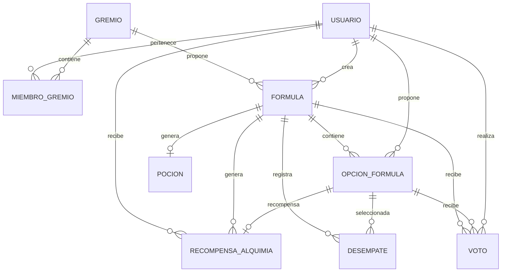

# ⚗️ Chemigram — Círculo de Alquimistas

Chemigram es una aplicación web inspirada en la alquimia, donde los usuarios pueden formar gremios, proponer fórmulas, participar en votaciones y crear pociones mediante decisiones colectivas.

El sistema combina una arquitectura **frontend-backend**, autenticación de usuarios, persistencia de información en MySQL y comunicación en tiempo real mediante WebSocket.

---

## 1. Arquitectura del proyecto

Chemigram utiliza una arquitectura cliente-servidor dividida en dos módulos independientes:

| Módulo | Tecnologías | Responsabilidad |
|---|---|---|
| Frontend | React, Vite, JavaScript, CSS | Interfaz de usuario y navegación |
| Backend | Java, Spring Boot, Maven | Lógica de negocio y API REST |
| Base de datos | MySQL | Persistencia de usuarios, gremios, fórmulas, votos y pociones |
| Comunicación en tiempo real | WebSocket, STOMP | Notificaciones de actividad en los gremios |
| Seguridad | Spring Security, JWT | Autenticación y protección de recursos |

### Estructura general

```text
Chemigram/
│
├── frontend/
│   ├── public/
│   ├── src/
│   │   ├── assets/
│   │   ├── components/
│   │   ├── context/
│   │   ├── hooks/
│   │   ├── pages/
│   │   ├── services/
│   │   ├── styles/
│   │   └── util/
│   ├── package.json
│   └── .env
│
├── backend/
│   ├── src/
│   │   └── main/
│   │       ├── java/
│   │       └── resources/
│   ├── pom.xml
│   └── .env
│
└── README.md
```

El frontend consume los servicios del backend mediante solicitudes HTTP. El backend procesa las solicitudes, ejecuta las reglas de negocio y consulta o modifica la información almacenada en MySQL.

---

## 2. Base de datos y relaciones

Chemigram utiliza MySQL para almacenar la información de la aplicación.

### Entidades principales

- **Usuario:** almacena los datos de los alquimistas, sus especialidades, credenciales y puntuaciones.
- **Gremio:** representa los círculos de alquimistas.
- **MiembroGremio:** relaciona usuarios con gremios y permite identificar al catador.
- **Formula:** representa una propuesta de creación de una poción.
- **OpcionFormula:** almacena las propuestas de ingredientes, métodos y frascos.
- **Voto:** registra las decisiones de los usuarios sobre las opciones.
- **Pocion:** almacena el resultado de una fórmula finalizada.
- **Desempate:** registra las decisiones del catador cuando existe un empate.
- **RecompensaAlquimia:** registra los puntos otorgados por las acciones de los usuarios.

### Diagrama de relaciones



*Nota: el diagrama representa las relaciones del modelo lógico. Los nombres y cardinalidades definitivos deben contrastarse con las entidades y restricciones actuales de JPA.*

---

## 3. API REST

El backend expone servicios REST para gestionar los recursos de Chemigram.

La API utiliza JSON para intercambiar información entre el frontend y el backend.

### Endpoints identificados

| Método | Ruta | Descripción |
|---|---|---|
| POST | `/api/usuarios` | Registrar un usuario |
| POST | `/api/usuarios/login` | Iniciar sesión |
| GET | `/api/ranking` | Consultar el ranking de alquimistas |
| GET | `/api/gremios` | Listar gremios |
| POST | `/api/gremios` | Crear un gremio |
| GET | `/api/gremios/{id}/miembros` | Consultar miembros |
| POST | `/api/gremios/{id}/miembros` | Unirse a un gremio |
| PUT | `/api/gremios/{id}/catador/{usuarioId}` | Asignar el rol de catador |
| DELETE | `/api/gremios/{id}/catador` | Retirar el rol de catador |

**Autenticación:** los endpoints protegidos requieren un token JWT en el encabezado:

```http
Authorization: Bearer <token>
```

Los endpoints de fórmulas, opciones, votos, desempates y pociones deben documentarse con sus rutas definitivas tomadas de los controladores del proyecto.

---

## 4. Comunicación en tiempo real con WebSocket

Chemigram incorpora WebSocket con el protocolo STOMP para enviar notificaciones de actividad a los integrantes de los gremios.

### Configuración

| Elemento | Valor |
|---|---|
| Endpoint de conexión | `/ws-chemigram` |
| Broker de mensajes | `/topic` y `/queue` |
| Prefijo de aplicación | `/app` |
| Prefijo de usuarios | `/user` |
| Canal de notificaciones del gremio | `/topic/gremio/{gremioId}` |

### Funcionamiento

1. El frontend establece una conexión WebSocket enviando el token JWT.
2. El backend valida la autenticación.
3. El usuario se suscribe al canal del gremio correspondiente.
4. El backend verifica que el usuario pertenezca al gremio.
5. Cuando se registra un voto, el backend puede emitir una notificación.
6. Los clientes suscritos reciben el evento sin necesidad de actualizar la página.

### Ejemplo de notificación

```json
{
  "tipo": "VOTO_ACTUALIZADO",
  "formulaId": 1,
  "categoria": "INGREDIENTE",
  "usuario": "nombreUsuario"
}
```

El frontend utiliza `@stomp/stompjs` para establecer la conexión, administrar las suscripciones y recibir los mensajes.

---

## 5. Instalación y ejecución

### Requisitos

- Java y JDK.
- Node.js y npm.
- MySQL.
- Visual Studio Code u otro editor.
- Postman (opcional, para probar la API).

### 5.1. Configurar la base de datos

1. Iniciar el servidor MySQL.
2. Crear la base de datos `chemigram`.
3. Configurar las credenciales y la conexión en la configuración del backend.
4. Verificar que el backend pueda conectarse correctamente.

### 5.2. Ejecutar el backend

Abrir una terminal dentro de la carpeta `backend`.

Compilar el proyecto:

```powershell
.\mvnw.cmd clean compile
```

Ejecutar Spring Boot:

```powershell
.\mvnw.cmd spring-boot:run
```

El backend estará disponible en:

```text
http://localhost:8080
```

### 5.3. Ejecutar el frontend

Abrir otra terminal dentro de la carpeta `frontend`.

Instalar dependencias:

```bash
npm install
```

Configurar las variables de entorno en el archivo `.env`:

```env
VITE_API_URL=http://localhost:8080
VITE_WS_URL=ws://localhost:8080/ws-chemigram
```

Iniciar el servidor de desarrollo:

```bash
npm run dev
```

El frontend estará disponible en:

```text
http://localhost:5173
```

### 5.4. Orden de ejecución

1. Iniciar MySQL.
2. Ejecutar el backend.
3. Ejecutar el frontend.
4. Abrir `http://localhost:5173` en el navegador.

---

## Tecnologías utilizadas

- Java
- Spring Boot
- Spring Security
- JWT
- Maven
- MySQL
- React
- Vite
- JavaScript
- CSS
- Axios
- WebSocket
- STOMP

---

## Estado del proyecto

Chemigram integra una aplicación web con gestión de usuarios, gremios, fórmulas, votaciones y creación de pociones. La documentación de endpoints y las pruebas funcionales se completarán conforme se verifiquen los módulos del sistema.
